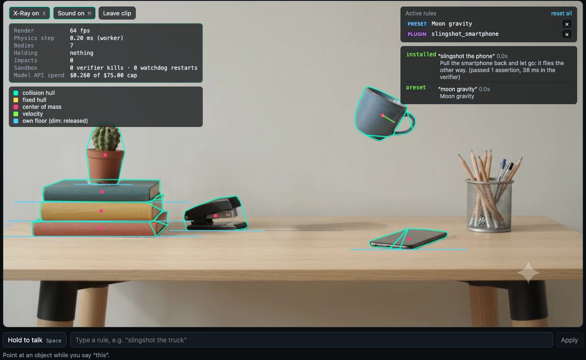
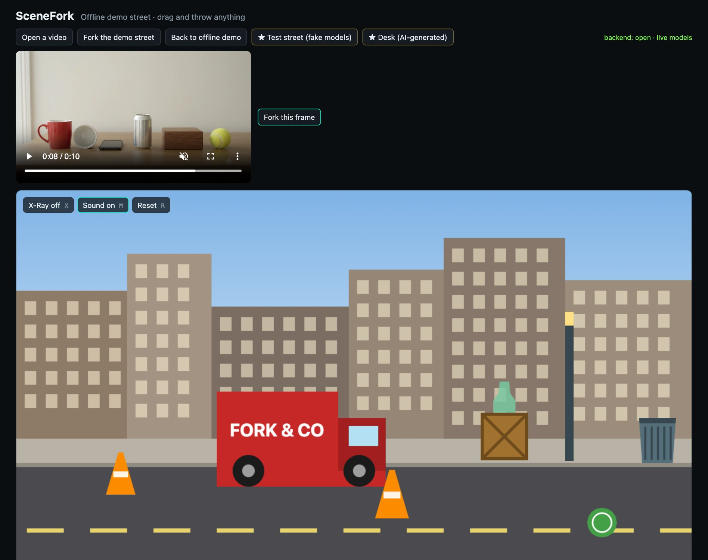
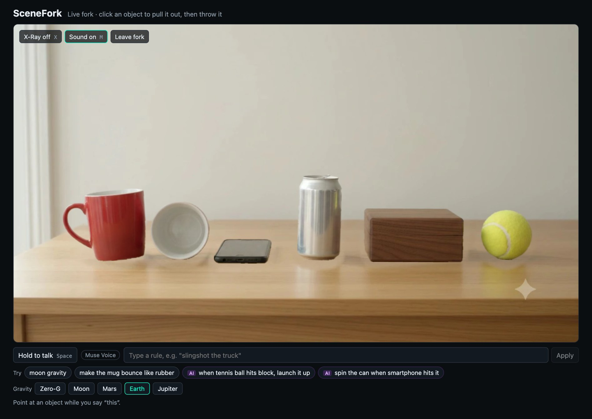
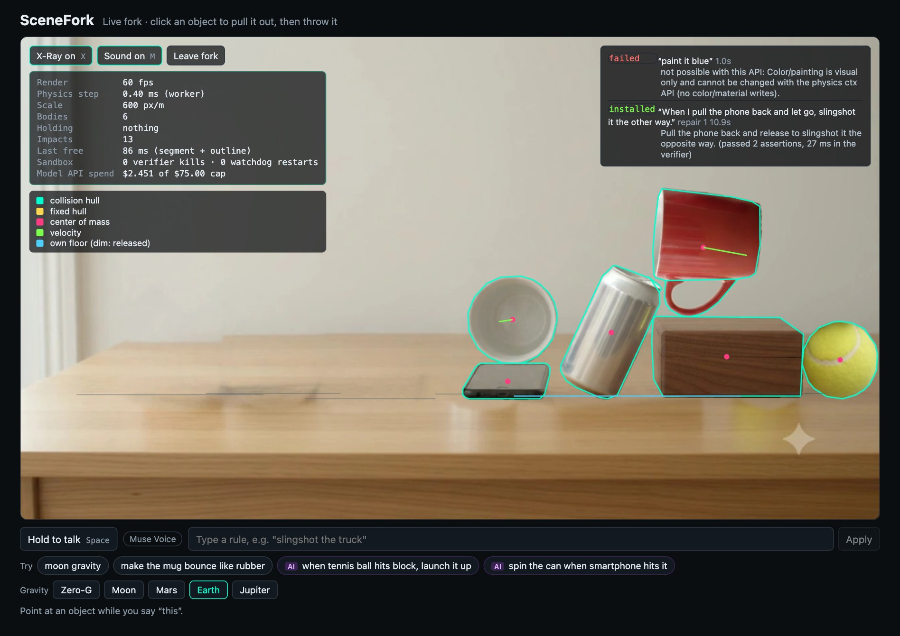
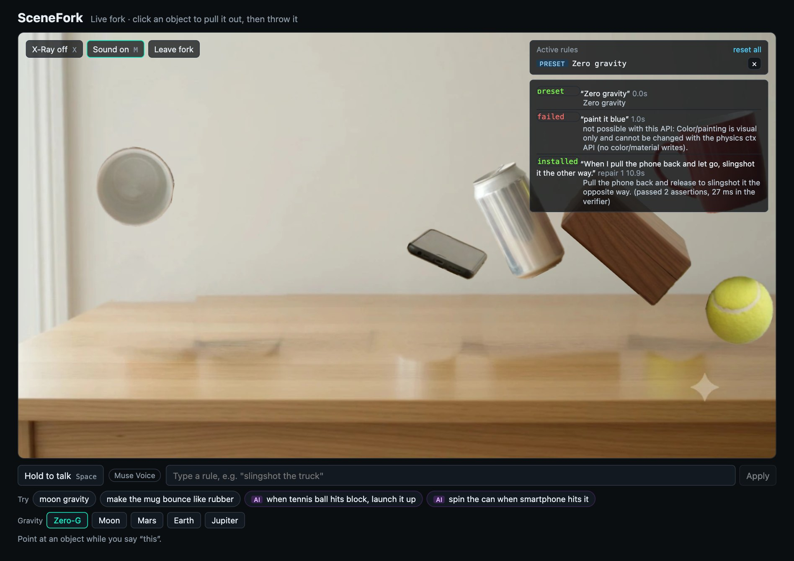
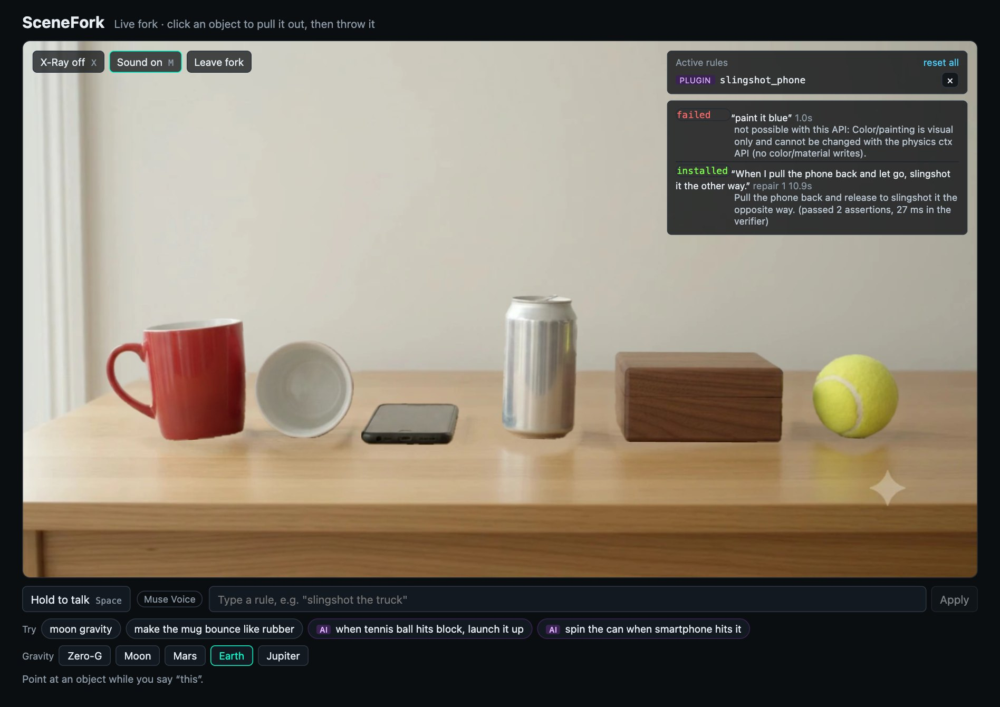
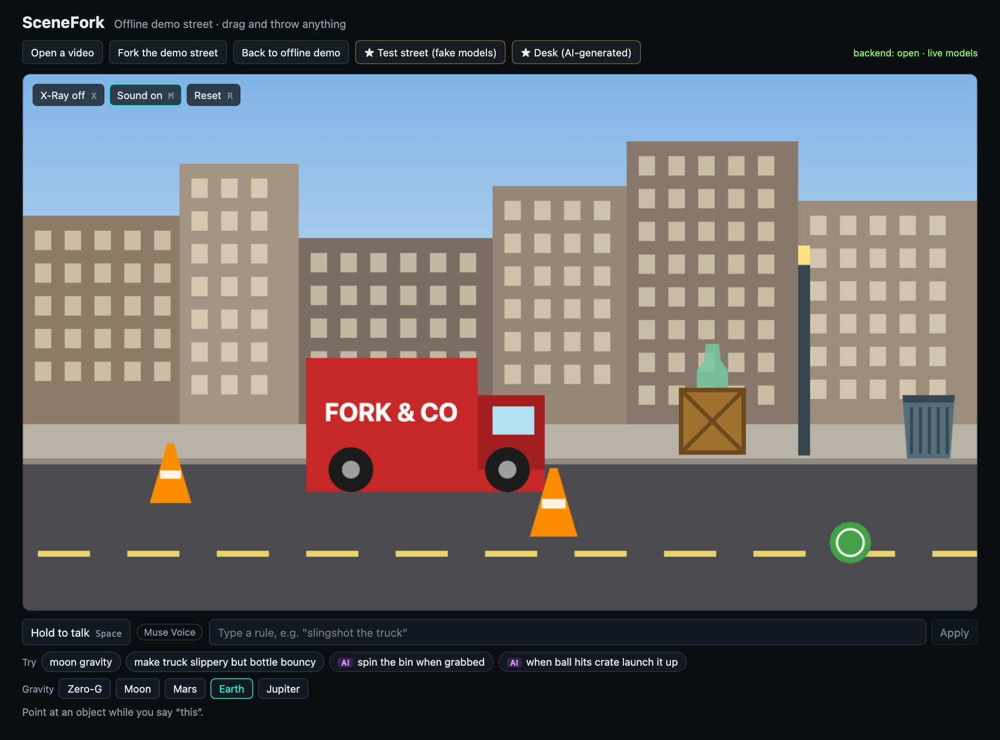
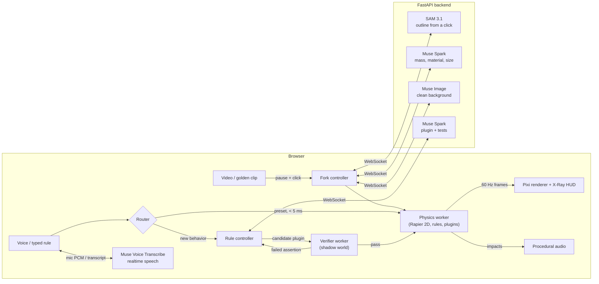

# SceneFork

**Pause a video, pull real objects out of the frame, throw them around, and rewrite the laws of physics by voice.**



You pause any clip and click an object. It lifts out of the video as a physical body: it has a mass, a material and a sound, and the background behind it is painted back in. Throw it into other things. Then say "moon gravity", or point at something and say "slingshot this". SceneFork turns the sentence into a small program, tests it in a shadow copy of the scene, and only then lets it run.

Built for the Meta Global AI Developer Hackathon on Meta's Model API. It's open source under the [MIT licence](LICENSE).

## See it

**Open any video, pause it, and fork the frame.**



**Click objects to free them.** Muse Spark then suggests rules for what's in the scene. Chips tagged AI are generated and tested when you click them.



**X-Ray shows what the models built:** collision hulls, centers of mass, velocity, timings and live spend.



**Change physics in one click or by voice.** Here is zero gravity.



**New rules are tested before they run, and impossible ones are refused with a reason.**



**The offline demo street** works with no backend at all.



## How it works



| Step | Meta model | What it does |
|---|---|---|
| Click an object | **SAM 3.1** (`sam-3.1`) | One point prompt gives the object's mask (IoU 0.997 against ground truth in our probe). The backend turns it into a hull of convex parts and an alpha-cut sprite. |
| It becomes physical | **Muse Spark** (`muse-spark-1.3`) | Looks at the outlined object and returns label, mass, bounciness, friction, material and real height, constrained by a JSON schema and clamped. The body moves at once with defaults; the grounded values patch in when it comes to rest. |
| The hole fills in | **Muse Image** (`muse-image-1.0`) | Repaints only a crop around the object's region, aligned and composited back, so nothing else in the frame changes. |
| Hold Space and speak | **Muse Voice Transcribe** (`muse-voice-transcribe-1.0`) | Mic audio streams through the backend to the realtime API, biased toward the objects on screen. Presets can fire from a partial transcript before you let go; the final arrives about 0.45 s after release. (Chrome's own speech recognition is the fallback when the backend runs fake models.) |
| "Slingshot this" | **Muse Spark** | Writes a JavaScript plugin against a small physics API (`shared/ctx.d.ts`), declares which fields it writes, and writes its own assertions. |

## Rules that are tested before they run

A spoken rule never goes straight into the live simulation:

1. **Presets** ("zero gravity", "Mars", "Jupiter", "make this bouncy", "slow motion", "reset") match locally, in under 5 ms, with no model call. Zero gravity lifts the whole scene off its floors to float; Earth, Moon, Mars and Jupiter use their real surface gravity, and each has a one-click button too. "This" and "that" resolve to whatever the pointer rested on while you spoke.
2. **Anything else** goes to Muse Spark, which returns a plugin plus 1-4 assertions, for example "after dragging the truck 1 m left and releasing, its x-velocity at tick 3 is above 3 m/s".
3. A **verifier worker** replays each assertion in a copy of the current scene. It also runs the same checks *without* the plugin, and rejects the plugin if they pass anyway (a no-op). It fails on NaN, speeds over 200 m/s, and writes to fields the plugin didn't declare.
4. On failure, the exact failed assertion goes back to the model, for up to **2 repairs**. If it still fails, the closest preset applies, or nothing does, and the HUD says why.

The physics worker is the sandbox boundary: no DOM, network APIs removed, `postMessage` captured before any plugin loads. Plugin code is parsed with Acorn against an allowlist first. A plugin stuck in a loop is killed by the verifier after 300 ms. If one freezes the live simulation, a watchdog restarts it within 150 ms from the last snapshot, drops the plugin, and names it in the HUD.

Rules stack. Each field (gravity, an object's mass, and so on) keeps a stack of values, so removing a rule restores exactly what was there before, whatever order rules came and went in.

**Not sure what to say?** As soon as objects are freed, Muse Spark looks at what's in the scene and offers four ideas as chips under the voice bar, such as "when mug hits stapler, launch mug up" or "make the cactus bounce like rubber". A chip runs exactly like a spoken command; chips tagged **AI** are generated and verified, the others are instant presets. It costs about $0.002 per new set of objects and is cached per scene.

## Golden clips

Demo clips are exported once (`backend/scripts/export_golden.py`) and then play from static files with no backend. Clicks resolve by point-in-polygon, so frees are instant. The export removes objects one after another on a running plate and cuts each object's background patch from the final empty plate, so freeing objects in any order, stacks included, gives a consistent background. See [`docs/demo-runbook.md`](docs/demo-runbook.md).

## Run it locally

SceneFork runs in two modes. **Fake models** are the default: they're free, need no API key, and are the quickest way to try it. **Live models** use the real Meta models and spend your API credits.

| | Fake models (default) | Live models |
|---|---|---|
| API key | Not needed | Needed |
| Outlines and repaints | OpenCV stand-ins | SAM 3.1 and Muse Image |
| Spoken commands | Chrome's speech recognition | Muse Voice |
| New rules | Four built-in commands: slingshot, spin, sideways gravity, heavy. Anything else comes back as "not possible". | Any rule; Muse Spark writes it |

### 1. Install the requirements

- [Node.js](https://nodejs.org) 22 or newer
- [pnpm](https://pnpm.io/installation)
- Python 3.12 or newer
- [uv](https://docs.astral.sh/uv/)
- Google Chrome, for voice and the end-to-end tests

### 2. Get the code and its dependencies

```bash
git clone https://github.com/suryafk/scenefork.git
```

```bash
cd scenefork
```

```bash
pnpm --dir frontend install
```

```bash
cd backend && uv sync && cd ..
```

### 3. Start the backend

In one terminal, from the repo root:

```bash
cd backend && uv run uvicorn app.asgi:app --port 8000
```

### 4. Start the frontend

In a second terminal, from the repo root:

```bash
pnpm --dir frontend dev
```

### 5. Open the app

Go to http://localhost:5173 in Chrome. The bar above the stage shows the connection, for example `backend: open · fake models (free)`.

### Or run it with Docker

Docker runs both halves from one command, so there's nothing to install except Docker. You need [Docker Desktop](https://docs.docker.com/desktop/), or Docker Engine with the Compose plugin (version 2.24 or newer).

From the repo root:

```bash
docker compose up --build
```

The first build takes a few minutes: it installs the dependencies and builds the frontend. When it's done, go to http://localhost:5173 in Chrome. The bar above the stage should say `backend: open · fake models (free)`.

To stop it:

```bash
docker compose down
```

Two containers run:

| Service | Port | What it is |
|---|---|---|
| `web` | 5173 | The built frontend, served by nginx |
| `backend` | 8000 | The FastAPI backend (health check at `/health`) |

**Live models.** Create `backend/.env` as described in [Use the real Meta models](#use-the-real-meta-models), then recreate the backend so it reads the file:

```bash
docker compose up -d --force-recreate backend
```

**Your data.** The spend ledger and the response cache live in Docker volumes (`spend` and `cache`), so they survive restarts and the spend cap keeps counting. `docker compose down -v` deletes them, which also resets the ledger the cap counts against.

**A different address.** The address the browser uses for the backend is fixed when the frontend is built (default `http://localhost:8000`). To change it, rebuild with `--build-arg VITE_BACKEND_URL=<address>`, and add the frontend's address to `SCENEFORK_ALLOWED_ORIGINS` for the backend.

**Each half on its own.** The [`Dockerfile`](Dockerfile) has one target per half:

```bash
docker build --target backend -t scenefork-backend .
```

```bash
docker build --target web -t scenefork-web .
```

### Try it

1. Drag anything in the offline demo street and throw it.
2. Click **★ Desk (AI-generated)**, then **Fork this frame**, and click objects to pull them out.
3. Press **X** to see collision shapes, or click **Zero-G** or **Jupiter**.
4. Hold **Space** and say "moon gravity". You can also type it in the rule box.
5. To use your own video, click **Open a video**, pause it, and click **Fork this frame**.

Good clips are landscape, under 30 seconds, and have a still camera at the moment you fork. Objects should stand out from what's behind them. Each one should fill 5-40% of the frame's width. [The demo runbook](docs/demo-runbook.md) has more detail.

| Control | Action |
|---|---|
| Drag | Throw an object |
| **X** | X-Ray |
| **M** | Mute |
| Hold **Space** | Speak a rule, or type it in the rule box |
| **R** | Reset the demo street |

### Use the real Meta models

Live calls cost money. Expect about $0.014 per freed object and about $0.007 per generated rule attempt. Each live background repaint takes about 20 s, so an object can show twice until its repaint lands.

1. Copy the settings file:

   ```bash
   cp backend/.env.example backend/.env
   ```

2. Edit `backend/.env`, setting your Model API key and turning live models on:

   ```
   MODEL_API_KEY=your-key
   SCENEFORK_ADAPTERS=live
   ```

3. Restart the backend. The bar should now say `live models`.

Every live call goes through a spend ledger (`backend/.spend/ledger.jsonl`) with a hard cap. Identical requests replay free from a disk cache (`backend/.cache`). Never commit `backend/.env`.

### Settings

Set these in `backend/.env` or the environment.

| Setting | Default | What it does |
|---|---|---|
| `MODEL_API_KEY` | none | Your Meta Model API key |
| `SCENEFORK_ADAPTERS` | `fake` | `live` uses the real models |
| `SPEND_CAP_USD` | `75` | Refuses live calls once the all-time total reaches this |
| `SCENEFORK_DEV_CACHE` | `1` | `0` turns off the disk cache |
| `SCENEFORK_DEMO_TOKEN` | none | Requires a shared key. Open the app with `#k=<key>` on the URL. |
| `SCENEFORK_ALLOWED_ORIGINS` | `localhost:5173`, `127.0.0.1:5173` | Comma-separated origins, each with `http://`. Set this if the frontend runs elsewhere. |
| `SCENEFORK_CODEGEN_EFFORT` | `minimal` | Muse Spark reasoning effort for writing rules |

To point the frontend at a backend on another address, set `VITE_BACKEND_URL` when you start it.

### Troubleshooting

| Problem | What to do |
|---|---|
| The bar shows the backend as disconnected | Check the backend terminal is running on port 8000. Golden clips and the offline street still work without it. |
| Voice does nothing | Use Chrome, allow the microphone, and click somewhere outside a button before holding Space. |
| A rule comes back "not possible" in fake mode | That's expected for anything beyond the four built-in commands. Turn on live models for the rest. |
| A clip is refused | Clips over 30 seconds are refused. Trim it first. |
| A click says "try another spot" | Masks wider than 75% of the frame count as background. Click a smaller, clearer object. |
| Live calls are refused | The spend cap was reached. Raise `SPEND_CAP_USD`. |

## Tests

| Suite | Command | Covers |
|---|---|---|
| Frontend unit (Vitest, Rapier in WASM) | `pnpm --dir frontend test` | physics, floors and stacking, rule stack, sandbox parser, verifier, voice router, repair loop |
| Backend (pytest) | `cd backend && uv run pytest` | WebSocket protocol, spend cap and cache, mask compiling, live adapters against stubs, golden export |
| End to end (Playwright) | `pnpm --dir frontend e2e` | golden clip, live fork, presets, codegen pass and graceful failure, demo key |

No test calls a paid model. Contract fixtures in `shared/fixtures/` are checked by both stacks. Model quality is measured separately by the [evals](evals/README.md), against the live API.

## Measured

| | |
|---|---|
| Click to freed object (live, from home) | ~1.9-2.6 s (SAM 3.1 + outline) |
| Grounding (Muse Spark, minimal reasoning) | ~2.3 s |
| Background repaint (Muse Image, one at a time) | ~20 s per object |
| Voice: key-up to final transcript | ~0.45 s (Muse Voice realtime) |
| Plugin generation | ~5 s, ~$0.007 per attempt |
| Verifier run | 10-40 ms |
| Physics step | ~0.2 ms for 8 bodies, 60 fps render |
| Mutator eval (10 commands × 5 runs, real verifier) | **48/50 runs pass, 10/10 commands meet the 4/5 bar**, 44 right on the first call ([results](evals/results/mutator-latest.md)) |
| Grounding eval (golden objects) | **8/8** label, mass range and body type ([results](evals/results/grounding-latest.md)) |

## Layout

```
frontend/   Vite + React + TypeScript, Pixi v8, Rapier 2D (physics and verifier workers)
backend/    FastAPI: WebSocket session, model adapters, spend ledger, golden export
shared/     contracts both sides load: plugin API, JSON schemas, presets, fixtures
docs/       model probe results, demo runbook, demo video script and tools
evals/      mutator and grounding evals, with results
Dockerfile  backend and web images (docker-compose.yml runs both)
```

## Licence

[MIT](LICENSE)
