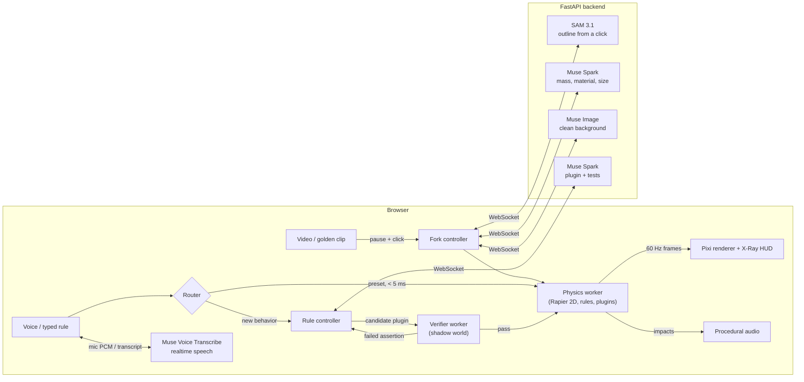

# SceneFork

**Pause a video, pull real objects out of the frame, throw them around, and rewrite the laws of physics by voice.**


You pause any clip and click an object. It lifts out of the video as a physical body: it has a mass, a material and a sound, and the background behind it is painted back in. Throw it into other things. Then say "moon gravity", or point at something and say "slingshot this". SceneFork turns the sentence into a small program, tests it in a shadow copy of the scene, and only then lets it run.

Built for the Meta Global AI Developer Hackathon on Meta's Model API.

## How it works



| Step | Meta model | What it does |
|---|---|---|
| Click an object | **SAM 3.1** (`sam-3.1`) | One point prompt gives the object's mask (IoU 0.997 against ground truth in our probe). The backend turns it into a hull of convex parts and an alpha-cut sprite. |
| It becomes physical | **Muse Spark** (`muse-spark-1.3`) | Looks at the outlined object and returns label, mass, bounciness, friction, material and real height, constrained by a JSON schema and clamped. The body moves at once with defaults; the grounded values patch in when it comes to rest. |
| The hole fills in | **Muse Image** (`muse-image-1.0`) | Repaints only a crop around the object's region, aligned and composited back, so nothing else in the frame changes. |
| Hold Space and speak | **Muse Voice Transcribe** (`muse-voice-transcribe-1.0`) | Mic audio streams through the backend to the realtime API, biased toward the objects on screen. Presets can fire from a partial transcript before you let go; the final arrives about 0.45 s after release. (Chrome's own speech recognition is the fallback when the backend runs fake models.) |
| "Slingshot this" | **Muse Spark** | Writes a JavaScript plugin against a small physics API (`shared/ctx.d.ts`), declares which fields it writes, and writes its own assertions. |

## Rules that are tested before they run

A spoken rule never goes straight into the live simulation:

1. **Presets** ("zero gravity", "Mars", "Jupiter", "make this bouncy", "slow motion", "reset") match locally, in under 5 ms, with no model call. Zero gravity lifts the whole scene off its floors to float; Earth, Moon, Mars and Jupiter use their real surface gravity, and each has a one-click button too. "This" and "that" resolve to whatever the pointer rested on while you spoke.
2. **Anything else** goes to Muse Spark, which returns a plugin plus 1-4 assertions, for example "after dragging the truck 1 m left and releasing, its x-velocity at tick 3 is above 3 m/s".
3. A **verifier worker** replays each assertion in a copy of the current scene. It also runs the same checks *without* the plugin, and rejects the plugin if they pass anyway (a no-op). It fails on NaN, speeds over 200 m/s, and writes to fields the plugin didn't declare.
4. On failure, the exact failed assertion goes back to the model, for up to **2 repairs**. If it still fails, the closest preset applies, or nothing does, and the HUD says why.

The physics worker is the sandbox boundary: no DOM, network APIs removed, `postMessage` captured before any plugin loads. Plugin code is parsed with Acorn against an allowlist first. A plugin stuck in a loop is killed by the verifier after 300 ms. If one freezes the live simulation, a watchdog restarts it within 150 ms from the last snapshot, drops the plugin, and names it in the HUD.

Rules stack. Each field (gravity, an object's mass, and so on) keeps a stack of values, so removing a rule restores exactly what was there before, whatever order rules came and went in.

**Not sure what to say?** As soon as objects are freed, Muse Spark looks at what's in the scene and offers four ideas as chips under the voice bar, such as "when mug hits stapler, launch mug up" or "make the cactus bounce like rubber". A chip runs exactly like a spoken command; chips tagged **AI** are generated and verified, the others are instant presets. It costs about $0.002 per new set of objects and is cached per scene.

## Golden clips

Demo clips are exported once (`backend/scripts/export_golden.py`) and then play from static files with no backend. Clicks resolve by point-in-polygon, so frees are instant. The export removes objects one after another on a running plate and cuts each object's background patch from the final empty plate, so freeing objects in any order, stacks included, gives a consistent background. See [`docs/demo-runbook.md`](docs/demo-runbook.md).

## Run it

Requirements: Node 22+ with pnpm, Python 3.12+ with [uv](https://docs.astral.sh/uv/), Chrome (for voice).

```bash
pnpm --dir frontend install
cd backend && uv sync && cd ..
```

```bash
cd backend && uv run uvicorn app.asgi:app --port 8000
```

```bash
pnpm --dir frontend dev
```

Open http://localhost:5173. Out of the box the backend uses **free fake models** (OpenCV stand-ins), so everything runs without an API key. For the real Meta models, put `MODEL_API_KEY=...` and `SCENEFORK_ADAPTERS=live` in `backend/.env`. Every live call goes through a spend ledger with a hard cap (`SPEND_CAP_USD`), and identical requests replay from a disk cache.

Controls: drag to throw, **X** for X-Ray, **M** to mute, hold **Space** to speak a rule (or type it), **R** to reset the demo street.

## Tests

| Suite | Command | Covers |
|---|---|---|
| Frontend unit (Vitest, Rapier in WASM) | `pnpm --dir frontend test` | physics, floors and stacking, rule stack, sandbox parser, verifier, voice router, repair loop |
| Backend (pytest) | `cd backend && uv run pytest` | WebSocket protocol, spend cap and cache, mask compiling, live adapters against stubs, golden export |
| End to end (Playwright) | `pnpm --dir frontend e2e` | golden clip, live fork, presets, codegen pass and graceful failure, demo key |

No test calls a paid model. Contract fixtures in `shared/fixtures/` are checked by both stacks. Model quality is measured separately by the [evals](evals/README.md), against the live API.

## Measured

| | |
|---|---|
| Click to freed object (live, from home) | ~1.9-2.6 s (SAM 3.1 + outline) |
| Grounding (Muse Spark, minimal reasoning) | ~2.3 s |
| Voice: key-up to final transcript | ~0.45 s (Muse Voice realtime) |
| Plugin generation | ~5 s, ~$0.007 per attempt |
| Verifier run | 10-40 ms |
| Physics step | ~0.2 ms for 8 bodies, 60 fps render |
| Mutator eval (10 commands × 5 runs, real verifier) | **48/50 runs pass, 10/10 commands meet the 4/5 bar**, 44 right on the first call ([results](evals/results/mutator-latest.md)) |
| Grounding eval (golden objects) | **8/8** label, mass range and body type ([results](evals/results/grounding-latest.md)) |

## Layout

```
frontend/   Vite + React + TypeScript, Pixi v8, Rapier 2D (physics and verifier workers)
backend/    FastAPI: WebSocket session, model adapters, spend ledger, golden export
shared/     contracts both sides load: plugin API, JSON schemas, presets, fixtures
docs/       model probe results, demo runbook
```
